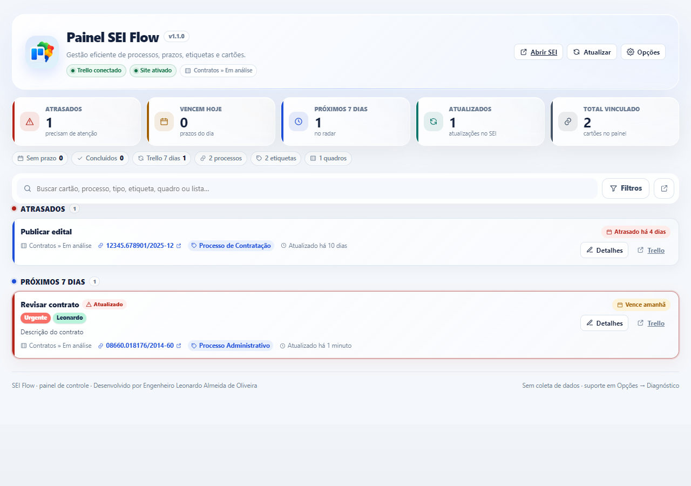
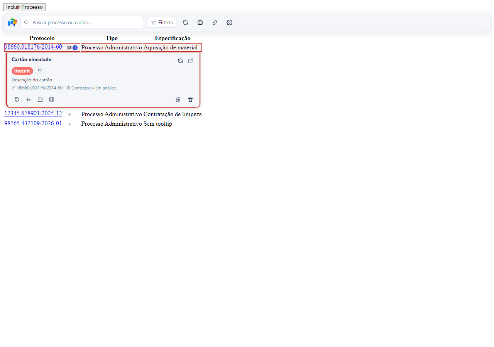
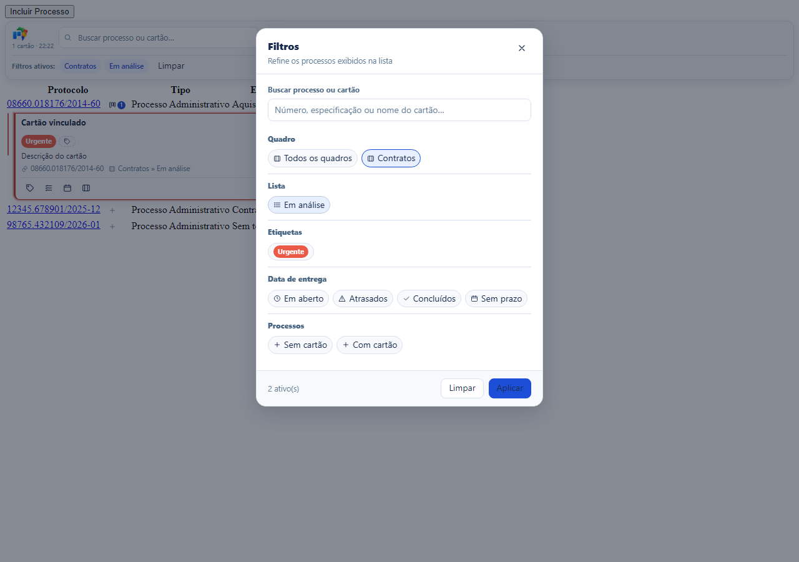
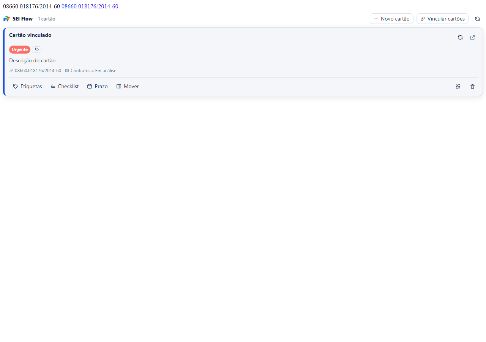
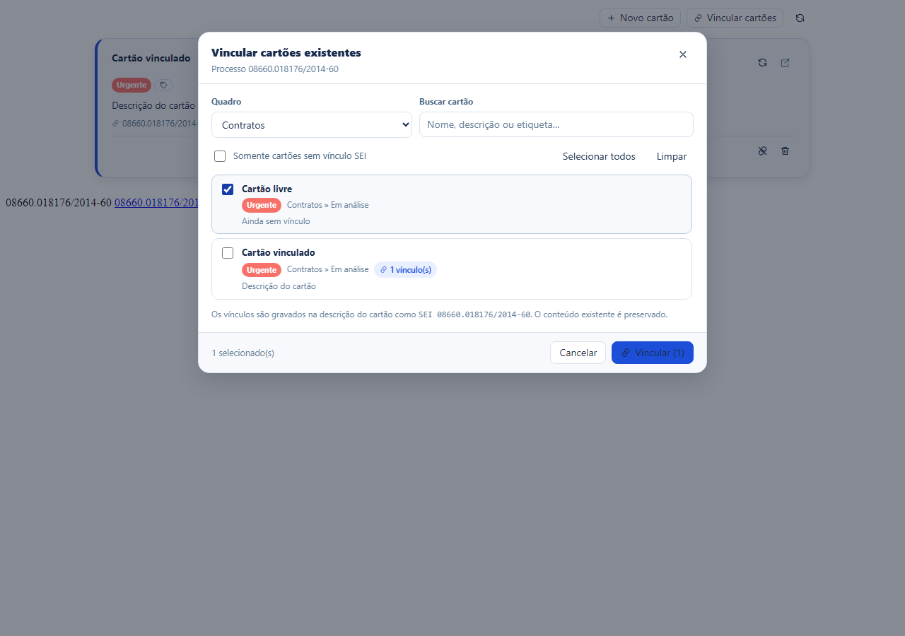
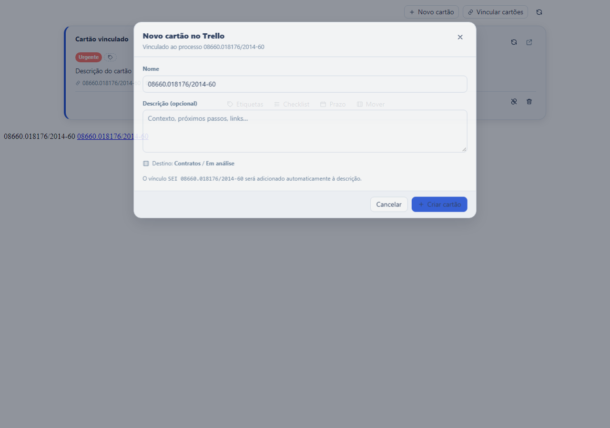
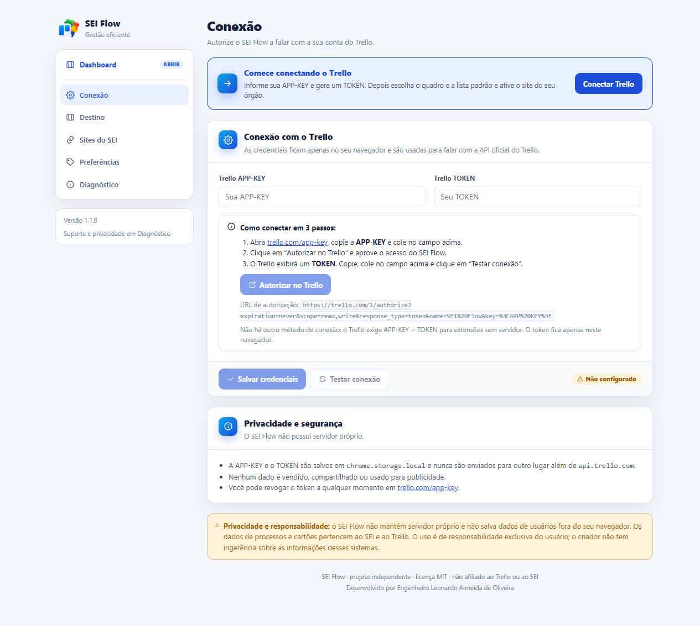

# SEI Flow

<p align="center">
  
</p>

Extensão para **Chrome, Firefox e Edge** que integra o **Trello** ao **SEI (Sistema Eletrônico de Informações)**. Crie, vincule e edite cartões diretamente na árvore e na lista de processos, sem alternar de aba.

O **Painel SEI Flow** é a página inicial da extensão: reúne prazos, etiquetas, tipos de processo, atualizações e edição completa dos cartões em um só lugar.

> Projeto independente, sem afiliação ao Trello/Atlassian ou ao SEI. Licença MIT.

## Baixar e instalar

- **Chrome / Edge:** [sei-flow-1.1.0-chrome.zip](https://github.com/engleonardo/SEI/releases/download/v1.1.0/sei-flow-1.1.0-chrome.zip)
- **Firefox:** [sei-flow-1.1.0-firefox.zip](https://github.com/engleonardo/SEI/releases/download/v1.1.0/sei-flow-1.1.0-firefox.zip)
- **Todas as versões:** [Releases](https://github.com/engleonardo/SEI/releases)

Depois de baixar, **extraia o zip** e carregue a pasta em `chrome://extensions` (ou `edge://extensions`) com o **Modo desenvolvedor** ativado. No Firefox, use `about:debugging` -> **Carregar extensão temporária** e selecione o `manifest.json` da pasta extraída.

## O que você resolve com o SEI Flow

- **Vínculo de mão dupla:** crie um cartão novo ou vincule um cartão que já existe no Trello ao processo do SEI.
- **Sincronização nos dois sentidos:** ao atualizar a extensão, o estado do Trello é relido e aplicado aos cartões, às etiquetas e às regras.
- **Vários cartões por processo**, todos visíveis e organizados.
- **Edição completa no SEI:** nome, descrição, etiquetas, checklist, prazo, quadro e lista, com botão **Concluir** no cartão.
- **Criação com contexto:** escolha etiquetas, quadro, lista, início e término na hora de criar o cartão.
- **Regras automáticas:** mova, etiquete e reorganize cartões vinculados ao SEI, com várias ações por regra e aplicação em cadeia.
- **Vinculação em lote:** selecione vários cartões do Trello e vincule a um ou vários processos.
- **Painel inicial completo:** prazos, etiquetas, tipos de processo, atualizações e busca, com edição direto no cartão.
- **Mover cartão sem popup:** o seletor de quadro/lista abre dentro do próprio cartão.
- **Usuário atribuído do SEI** visível no cabeçalho do processo.
- **Compatibilidade ampla:** funciona em qualquer domínio, pasta (`/sei/`, `/sip/`, `/web/sei/`) e versão do SEI (3.x, 4.x e 5.x), com seletores resilientes e fallbacks por texto.
- **Ativação por site:** você autoriza apenas as instalações do SEI que usa, ou opta por todos os sites.
- **Interface isolada:** React + Shadow DOM, sem quebrar o CSS do SEI.
- **Cache local:** menos chamadas à API do Trello e carregamento mais rápido.
- **Acessibilidade:** ações visíveis, navegação por teclado, foco gerenciado e contraste.

## Capturas de tela

<p align="center">
  
</p>
<p align="center">
  
  
</p>
<p align="center">
  
  
</p>
<p align="center">
  
  
</p>

## Funcionalidades

| Recurso | SEI Flow |
| --- | --- |
| Criar cartão a partir do processo | Sim |
| Vincular cartão existente do Trello | Sim |
| Vincular vários cartões de uma vez | Sim |
| Vincular cartões a vários processos em lote | Sim |
| Vários cartões por processo | Sim |
| Editar nome e descrição | Sim |
| Concluir e reabrir cartão sem exigir prazo | Sim |
| Criar cartão com etiquetas, quadro/lista, início e término | Sim |
| Regras automáticas com várias ações e execução em cadeia | Sim |
| Aplicar regra agora nos cartões vinculados | Sim |
| Criar, aplicar e remover etiquetas | Sim |
| Editar checklist (itens, concluir, remover) | Sim |
| Definir/remover prazo e conclusão | Sim |
| Mover cartão entre quadro/lista com seletor inline | Sim |
| Usuário atribuído do SEI no cabeçalho do processo | Sim |
| Desvincular sem excluir do Trello | Sim |
| Excluir cartão do Trello | Sim |
| Filtros por quadro, lista, etiqueta, prazo e cartão | Sim |
| Tema claro/escuro (claro padrão) | Sim |
| Cache e retry/backoff em 429/5xx | Sim |
| Painel SEI Flow como página inicial da extensão | Sim |
| Painel moderno com métricas resumidas e filtros recolhíveis | Sim |
| Botão Dashboard no menu de opções | Sim |
| Filtros do painel por etiqueta, tipo de processo, prazo, quadro, lista e atualização | Sim |
| Edição completa dos cartões pelo painel, sem modal | Sim |
| Métricas do painel refletem os filtros aplicados | Sim |
| Links dos processos abrem a página correspondente no SEI | Sim |
| Badge com processos atualizados no SEI | Sim |
| Atualizações do Trello (7/30 dias e desde a última visita) | Sim |
| Notificações diárias de prazos | Sim |
| Barra fixa, atalho de busca e filtros persistidos | Sim |
| Exportação CSV dos cartões filtrados | Sim |

## Instalação para desenvolvimento

Requisitos: **Node.js 22+** e npm.

```bash
npm install
npm run dev
```

O WXT abre o navegador de desenvolvimento. Para carregar manualmente:

```bash
npm run build
```

- **Chrome/Edge:** `chrome://extensions` -> Modo desenvolvedor -> *Carregar sem compactação* -> selecione `.output/chrome-mv3`.
- **Firefox:** `about:debugging#/runtime/this-firefox` -> *Carregar extensão temporária* -> selecione `.output/firefox-mv3/manifest.json`.
- **Edge:** `edge://extensions` -> Modo desenvolvedor -> *Carregar sem compactação* -> `.output/edge-mv3`.

### Primeiro uso

1. Clique no ícone da extensão: o **Painel SEI Flow** abre como página inicial.
2. Clique em **Conectar ao Trello** (ou abra **Opções**).
3. Informe a **APP-KEY** do Trello ([trello.com/app-key](https://trello.com/app-key)).
4. Gere e cole o **TOKEN** pelo link exibido na própria página.
5. Clique em **Testar conexão** e salve.
6. Escolha o **quadro** e a **lista** padrão.
7. Em **Sites do SEI**, ative o domínio da sua instituição (ou todos os sites).
8. Abra o SEI, recarregue a página e use o botão **Dashboard** no menu de opções quando quiser voltar ao painel.

> **Por que APP-KEY + TOKEN?** O Trello não oferece OAuth 2.0 para extensões sem servidor. O fluxo oficial client-side é a APP-KEY + TOKEN gerado em `trello.com/1/authorize`. A extensão monta essa URL para você e valida a conexão. Não é necessário criar backend nem configurar outro método.

## Como o vínculo funciona

O vínculo é gravado na descrição do cartão como uma linha:

```
SEI 08660.018176/2014-60
```

- É pesquisável no próprio Trello.
- Um cartão pode ter vários vínculos (vários processos).
- O texto existente da descrição é preservado.
- Desvincular remove **apenas** a linha do processo atual; o cartão continua no Trello.
- O marcador `SEI <processo>` é mantido para interoperabilidade entre versões.

## Painel SEI Flow

O painel abre pelo ícone da extensão e pelo menu **Dashboard** das opções.

- Métricas de atrasados, vencendo hoje, próximos 7 dias, atualizados e total vinculado.
- As métricas refletem os filtros aplicados e mostram o total de referência (por exemplo, `3 de 12 cartões`).
- Busca por cartão, processo, tipo, etiqueta, quadro, lista e também pela descrição do cartão.
- Filtros recolhíveis por quadro, lista, tipo de processo, etiqueta, prazo, atualização no Trello e atualização no SEI.
- Chips de lista com contagem por lista do quadro selecionado; o quadro padrão já vem escolhido.
- Agrupamento por prazo, quadro, lista, tipo de processo, etiqueta ou lista única.
- Edição direto no cartão, sem modal: clique no título, na descrição, nas etiquetas, no prazo, no checklist ou no destino.
- Botões **Concluir/Reabrir**, **Etiquetas**, **Checklist**, **Prazo** e **Mover** no rodapé do cartão, alinhados à esquerda.
- Links dos processos abrem a página correspondente no SEI.
- Exportação CSV dos cartões filtrados.
- Atalhos `/` e `Ctrl+K`/`Cmd+K` para focar a busca.

## Regras automáticas

Em **Opções -> Regras** você monta regras instantâneas, sem depender de automações do Trello.

- Valem **somente para cartões vinculados** a processos do SEI.
- Gatilhos: cartão concluído, entrada em uma lista, entrada em qualquer lista e **processo SEI atualizado (novidade)**.
- O gatilho de processo atualizado dispara quando a extensão lê a lista do SEI e o processo passa de sem novidade para com novidade (link vermelho). Roda uma vez por novidade, em todos os cartões vinculados ao processo que estejam no quadro da regra (e na lista escolhida, se houver).
- Funcionam nos dois sentidos: quando a extensão grava no Trello e também quando a mudança é feita no Trello e você atualiza (botão **Atualizar**, ao abrir o painel ou pela atualização automática das preferências).
- Cada regra mostra um contador de quantas vezes já foi aplicada (com data e se foi automática ou manual). O botão **Zerar contadores** limpa esse histórico.
- Várias ações por regra: mover para uma lista, mover para o topo, adicionar ou remover etiquetas.
- Regras em cadeia, com limite de 5 níveis e proteção contra loop.
- Uma regra não pode mover para duas listas diferentes ao mesmo tempo.
- **Aplicar agora** age só nos cartões que já estão na condição do gatilho, mostra quantos serão alterados e pede confirmação antes de gravar.
- **Desfazer** a última aplicação manual: devolve os cartões à lista de origem e reverte as etiquetas. Cartões que mudaram de lista depois são mantidos.
- As 4 regras iniciais vêm desativadas até você escolher as listas e etiquetas.

> Abra a lista de processos do SEI uma vez para o painel aprender tipo, especificação, URL e usuário atribuído de cada processo. Depois disso, os filtros por tipo e os links ficam completos.

## Privacidade, uso e responsabilidade

- O SEI Flow **não mantém servidor próprio** e **não salva dados de usuários fora do seu navegador**.
- A APP-KEY e o TOKEN do Trello ficam em `chrome.storage.local` e são usados apenas para falar com `api.trello.com`.
- Não há telemetria, anúncios, venda ou compartilhamento de dados.
- Os dados de processos e cartões pertencem ao SEI e ao Trello.
- O uso é de **responsabilidade exclusiva do usuário**; o criador não tem ingerência sobre as informações desses sistemas.
- Revogue o token quando quiser em [trello.com/app-key](https://trello.com/app-key).

Leia a política completa em [PRIVACY.md](PRIVACY.md).

## Publicação

Os passos para Chrome Web Store, Firefox Add-ons e Edge Add-ons estão em [docs/publicacao.md](docs/publicacao.md). A publicação automática a cada release está em [docs/store/auto-publish.md](docs/store/auto-publish.md).

```bash
npm run build && npm run zip
npm run build:firefox && npm run zip:firefox
npm run build:edge && npm run zip:edge
```

Os arquivos ficam em `.output/`.

## Desenvolvimento

### Comandos

```bash
npm run dev            # WXT em modo desenvolvimento (Chrome)
npm run dev:firefox    # WXT em modo desenvolvimento (Firefox)
npm run compile        # TypeScript (tsc --noEmit)
npm run lint           # ESLint
npm run test           # Vitest (unidade + componentes)
npm run test:e2e       # build + Playwright (UI e extensão real)
npm run build          # build Chrome
npm run build:firefox  # build Firefox
npm run build:edge     # build Edge
npm run zip            # pacote Chrome
npm run zip:firefox    # pacote Firefox
npm run zip:edge       # pacote Edge
npm run icons          # regenera os ícones PNG
npm run verify         # compile + lint + test + build
```

### Arquitetura

```
src/
  entrypoints/
    background.ts        # service worker: Trello, cache, ativação, injeção, badge
    dashboard/           # página inicial: métricas, filtros, edição e links do SEI
    options/             # conexão, destino, sites, preferências, diagnóstico
    sei-inject.ts        # script injetado por scripting.executeScript
  core/
    messaging/           # contrato RPC tipado content <-> background
    trello/              # client HTTP, cache, normalização, repositório
    sei/                 # detecção de página, número do processo, linhas, mount
    link/                # marcador SEI <processo>
    storage/             # settings, catálogo de processos e última aba
  ui/
    shadow.ts            # Shadow DOM + CSS compartilhado
    components/          # cartões, diálogos, pickers e seletor inline
    list/                # store e reconciliação da lista de processos
    styles.css           # tema claro/escuro
```

- O **background** concentra a API do Trello e o cache; o content script nunca fala direto com o Trello.
- O script é injetado **apenas** em origens autorizadas, via `scripting.executeScript`.
- A UI é montada em **Shadow DOM**; os diálogos usam um host global em overlay.
- O marcador de vínculo é a fonte de verdade; o cache é descartável.

### Testes

- **Vitest:** marcador, número do processo, detecção do SEI, client HTTP, filtros, catálogo de processos, modelo do painel e componentes.
- **Playwright:** UI injetada em fixtures de SEI 3.x/4.x, extensão real no Chromium (injeção, opções e painel) e painel com dados reais em cache (filtros, etiquetas, links do SEI, edição e badge).

```bash
npm test
npx playwright install chromium   # primeira vez
npm run test:e2e
```

## Roadmap

- **Próximas melhorias:** i18n (pt-BR/en), importação de CSV, modelos de cartão e automações por etiqueta.
- **Melhorias futuras:** suporte a múltiplas contas do Trello e relatórios por tipo de processo.

## Créditos e atribuição

Desenvolvido por **Engenheiro Leonardo Almeida de Oliveira**.

Este projeto é inspirado e compatível com o [SEI+Trello](https://github.com/luiscrjunior/sei-trello), criado por **Luís Carlos Reischak Júnior**, e com o fork comunitário [awlmdnitce/sei-trello](https://github.com/awlmdnitce/sei-trello). O marcador `SEI <processo>` é mantido para interoperabilidade. Veja [NOTICE](NOTICE) e [CREDITS.md](CREDITS.md).

O SEI Flow é de **uso livre** (MIT), mas quem copiar, modificar ou redistribuir deve **manter os créditos** ao autor deste projeto, **Engenheiro Leonardo Almeida de Oliveira**, e um link para https://github.com/engleonardo/SEI, além dos créditos do projeto que o inspirou. Os créditos não podem ser removidos de trabalhos derivados.

## Licença

MIT. Veja [LICENSE](LICENSE).
