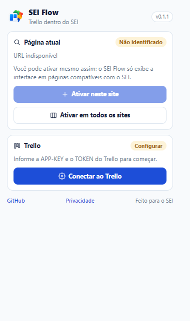

# SEI Flow

<p align="center">
  
</p>

Extensão para **Chrome, Firefox e Edge** que integra o **Trello** ao **SEI (Sistema Eletrônico de Informações)**. Crie, vincule e edite cartões diretamente na árvore e na lista de processos, sem alternar de aba.

> Projeto independente, sem afiliação ao Trello/Atlassian ou ao SEI. Licença MIT.

## Por que o SEI Flow?

A extensão original SEI+Trello só sabia **criar** cartões a partir do SEI. O SEI Flow nasceu para resolver isso e modernizar a experiência:

- **Vínculo de mão dupla**: crie um cartão novo **ou vincule um cartão que já existe no Trello** ao processo do SEI.
- **Vários cartões por processo**, empilhados e visíveis de uma vez (sem “existe mais de um cartão” escondido).
- **Edição completa no SEI**: nome, descrição, etiquetas, checklist, prazo, quadro e lista.
- **Vinculação em lote**: selecione vários cartões do Trello e vincule ao processo de uma vez.
- **Compatibilidade ampla**: funciona em qualquer domínio, pasta (`/sei/`, `/sip/`, `/web/sei/`) e versão do SEI (3.x, 4.x e 5.x), com seletores resilientes e fallbacks por texto.
- **Ativação por site**: nada de permissão em todos os sites por padrão. Você autoriza apenas as instalações do SEI que usa — ou opta por todos, se preferir.
- **Interface isolada**: React + Shadow DOM, sem quebrar o CSS do SEI e sem conflito com o tema.
- **Cache local**: menos chamadas à API do Trello e carregamento mais rápido.
- **Acessibilidade**: ações visíveis, navegação por teclado, foco gerenciado e contraste.

## Capturas de tela

<p align="center">
  
  
</p>
<p align="center">
  
  
</p>
<p align="center">
  
  
</p>

## Funcionalidades da Fase 1

| Recurso | SEI Flow |
| --- | --- |
| Criar cartão a partir do processo | ✅ |
| Vincular cartão existente do Trello | ✅ |
| Vincular vários cartões de uma vez | ✅ |
| Vários cartões por processo | ✅ |
| Editar nome e descrição | ✅ |
| Criar, aplicar e remover etiquetas | ✅ |
| Editar checklist (itens, concluir, remover) | ✅ |
| Definir/remover prazo e conclusão | ✅ |
| Mover cartão entre quadro/lista | ✅ |
| Desvincular sem excluir do Trello | ✅ |
| Excluir cartão do Trello | ✅ |
| Filtros na lista de processos | ✅ |
| Tema claro/escuro | ✅ |
| Cache e retry/backoff em 429/5xx | ✅ |
| Dashboard de prazos e notificações | 🔜 Fase 2 |
| Ações em lote entre processos | 🔜 Fase 3 |

## Instalação (desenvolvimento)

Requisitos: **Node.js 22+** e npm.

```bash
npm install
npm run dev
```

O WXT abre o navegador de desenvolvimento. Para carregar manualmente:

```bash
npm run build
```

- **Chrome/Edge**: `chrome://extensions` → Modo desenvolvedor → *Carregar sem compactação* → selecione `.output/chrome-mv3`.
- **Firefox**: `about:debugging#/runtime/this-firefox` → *Carregar extensão temporária* → selecione `.output/firefox-mv3/manifest.json`.
- **Edge**: `edge://extensions` → Modo desenvolvedor → *Carregar sem compactação* → `.output/edge-mv3`.

### Primeiro uso

1. Abra as opções da extensão (ela abre automaticamente na instalação).
2. Informe a **APP-KEY** do Trello ([trello.com/app-key](https://trello.com/app-key)).
3. Gere e cole o **TOKEN** pelo link exibido na própria página.
4. Clique em **Testar conexão** e salve.
5. Escolha o **quadro** e a **lista** padrão.
6. Em **Sites do SEI**, ative o domínio da sua instituição (ou “todos os sites”).
7. Abra o SEI e recarregue a página.

> **Por que APP-KEY + TOKEN?** O Trello não oferece OAuth 2.0 para extensões sem servidor. O fluxo oficial client-side é a APP-KEY + TOKEN gerado em `trello.com/1/authorize`. A extensão monta essa URL para você e valida a conexão. Não é necessário criar backend nem configurar outro método.

## Como o vínculo funciona

O vínculo é gravado na descrição do cartão como uma linha:

```
SEI 08660.018176/2014-60
```

- É pesquisável no próprio Trello.
- Um cartão pode ter vários vínculos (vários processos).
- O texto existente da descrição é preservado.
- Desvincular remove **apenas** a linha do processo atual; o cartão continua no Trello.
- O vínculo é compatível com cartões criados pela extensão original.

## Privacidade

- Sem servidor próprio, sem telemetria e sem anúncios.
- APP-KEY e TOKEN ficam em `chrome.storage.local`, no seu navegador.
- As únicas requisições externas vão para `api.trello.com`.
- Leia a [política de privacidade completa](PRIVACY.md).

## Desenvolvimento

### Scripts

```bash
npm run dev            # WXT em modo desenvolvimento (Chrome)
npm run dev:firefox    # WXT em modo desenvolvimento (Firefox)
npm run compile        # TypeScript (tsc --noEmit)
npm run lint           # ESLint
npm run test           # Vitest (unidade + componentes)
npm run test:e2e       # build + Playwright (UI e extensão real)
npm run build          # build Chrome
npm run build:firefox  # build Firefox
npm run build:edge     # build Edge
npm run zip            # pacote Chrome
npm run zip:firefox    # pacote Firefox
npm run zip:edge       # pacote Edge
npm run icons          # regenera os ícones PNG
npm run verify         # compile + lint + test + build
```

### Arquitetura

```
src/
  entrypoints/
    background.ts        # service worker: Trello, cache, ativação, injeção
    popup/               # status da aba + ativação do site
    options/             # conexão, destino, sites, preferências, diagnóstico
    sei-inject.ts        # script injetado por scripting.executeScript
  core/
    messaging/           # contrato RPC tipado content <-> background
    trello/              # client HTTP, cache, normalização, repositório
    sei/                 # detecção de página, número do processo, linhas, mount
    link/                # marcador SEI <processo>
    storage/             # settings tipadas
  ui/
    shadow.ts            # Shadow DOM + CSS compartilhado
    components/          # cartões, diálogos, pickers
    list/                # store e reconciliação da lista de processos
    styles.css           # tema claro/escuro
```

- O **background** concentra a API do Trello e o cache; o content script nunca fala direto com o Trello.
- O script é injetado **apenas** em origens autorizadas, via `scripting.executeScript`.
- A UI é montada em **Shadow DOM**; os diálogos usam um host global em overlay.
- O marcador de vínculo é a fonte de verdade; o cache é descartável.

Detalhes em [docs/superpowers/specs/2026-10-26-sei-flow-design.md](docs/superpowers/specs/2026-10-26-sei-flow-design.md).

### Testes

- **Vitest**: marcador, número do processo, detecção do SEI, client HTTP, filtros e componentes.
- **Playwright**: UI injetada em fixtures de SEI 3.x/4.x e teste de fumaça carregando a extensão real no Chromium (injeção, opções e popup).

```bash
npm test
npx playwright install chromium   # primeira vez
npm run test:e2e
```

## Publicação

Os passos para Chrome Web Store, Firefox Add-ons e Edge Add-ons estão em [docs/publicacao.md](docs/publicacao.md).

```bash
npm run build && npm run zip
npm run build:firefox && npm run zip:firefox
npm run build:edge && npm run zip:edge
```

Os arquivos ficam em `.output/`.

## Roadmap

- **Fase 2**: dashboard de prazos, notificações, badge e visão por quadro/lista.
- **Fase 3**: ações em lote entre processos, modelos de cartão e importação/exportação CSV.
- **Fase 4**: i18n (pt-BR/en) e melhorias contínuas de acessibilidade.

## Créditos

Este projeto é inspirado e compatível com o [SEI+Trello](https://github.com/luiscrjunior/sei-trello), criado por **Luís Carlos Reischak Júnior**, e com o fork comunitário [awlmdnitce/sei-trello](https://github.com/awlmdnitce/sei-trello). O marcador `SEI <processo>` foi mantido para interoperabilidade. Veja [NOTICE](NOTICE).

## Licença

MIT — veja [LICENSE](LICENSE).
